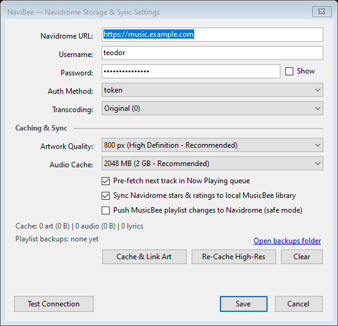

# NaviBee v1.0.2

NaviBee is a native **Navidrome and Subsonic / OpenSubsonic storage provider and two-way sync plugin** for [MusicBee](https://getmusicbee.com/). Engineered in pure C# (.NET Framework 4.8, x86) against the MusicBee plugin API, it mounts your remote Navidrome library directly inside MusicBee with instant startup readiness, HTTP `Range`-seekable streaming (including transcoded seeking), single-pass audio/artwork/lyrics caching, time-synced LRC lyrics, scrobbling, star/rating sync, and safe opt-in playlist synchronization.

---

## Installation

### Quick Install (Recommended)
1. Download **[`NaviBee_v1.0.2.zip`](https://github.com/Taffyex/NaviBee/releases/download/v1.0.2/NaviBee_v1.0.2.zip)** (or raw **[`mb_NaviBee.dll`](https://github.com/Taffyex/NaviBee/releases/download/v1.0.2/mb_NaviBee.dll)**) from the [latest release](https://github.com/Taffyex/NaviBee/releases).
2. In MusicBee, press `Ctrl + O` (or go to **Edit** > **Preferences**).
3. Select **Plugins**, click **Add Plugin**, and choose `NaviBee_v1.0.2.zip` (or `mb_NaviBee.dll`).
4. Click **Apply** and restart MusicBee.

### Manual Drop-in
1. Close MusicBee.
2. Copy `mb_NaviBee.dll` into your MusicBee plugins directory:
   - **Installer edition:** `C:\Program Files (x86)\MusicBee\Plugins\`
   - **Portable edition:** `<MusicBee Folder>\Plugins\`
   - **Windows Store:** `%APPDATA%\MusicBee\Plugins\`
3. Launch MusicBee.

---

## Settings



---

## Features

- **Native Storage Provider (`PluginType.Storage`)**: Browse `All Albums`, `Favorites`, `Top Rated`, `Most Played`, `Playlists`, and `Artist / Album` inside MusicBee, or import tracks directly into your main `Music` library via **Tools** > **Navidrome: Import All Tracks into Music Library**.
- **Time-Synced Lyrics & Local Cache**: Fetches OpenSubsonic `getLyricsBySongId` (with `getLyrics` fallback), formats synced `.lrc` lines with offset correction, caches lyrics locally under `NavidromeCache\Lyrics`, pre-fetches the next queued track, and injects lyrics in memory into MusicBee's Lyrics panel.
- **Smart Startup Catalog Cache & Instant Offline Ready**: Persists `catalog.json` locally, mounts `Navidrome:\` immediately on startup (no "File not found" race, cached tracks play even offline), checks `getScanStatus`, and refreshes server stars/ratings/plays on startup cache hits.
- **Range-Seekable Streaming & LRU Audio Cache**: Streams via `ConnectStream` with HTTP `Range` seeking, optional server transcoding (`Original`, `128`, `192`, `256`, `320 kbps` with `estimateContentLength=true` for transcoded seeking), configurable cache limits (`0` to `Unlimited`), single-pass stream-to-cache capture, and next-track queue prefetching.
- **High-Resolution Artwork Cache**: Background pre-warming and on-demand caching at configurable sizes (`Original`, `1200 px`, `800 px`, `300 px`).
- **Two-Way Sync & Safe Playlist Mode**:
  - Submits Now Playing updates and scrobbles on track completion (skip-aware so skipped tracks are not scrobbled).
  - Syncs loved status (`star` / `unstar`) and 1-5 star ratings (`setRating`) cleanly without overwriting server values during ordinary tag edits.
  - **Safe opt-in playlist push (off by default)**: never deletes server playlists when a MusicBee playlist is deleted, never sends empty playlists, never overwrites unlinked same-name server playlists or playlists owned by other users, and saves verified JSON backups (`NavidromeCache\PlaylistBackups\`) before every update.
- **Portable-Aware & Encrypted**: Stores cache and settings under MusicBee's persistent storage path and encrypts credentials with Windows DPAPI (`ProtectedData`).

---

## Configuration

1. Open **Edit** > **Preferences** > **Plugins** > **Navidrome Storage & Sync** > **Configure**.
2. Enter your **Navidrome URL** (for example `https://music.example.com` or `http://localhost:4533`), **Username**, and **Password**.
3. Select **Auth Method**:
   - `token` (MD5 salted token — recommended for Navidrome and modern Subsonic servers).
   - `hexPass` (hex-encoded password for legacy servers).
4. Click **Test Connection**, then **Save**.

---

## Building from Source

NaviBee targets .NET Framework 4.8 (x86) to match the 32-bit MusicBee host architecture.

```powershell
dotnet build NaviBee.sln -c Release -warnaserror
```

The compiled binary is written to `src/NaviBee/bin/mb_NaviBee.dll`.

---

## License

MIT License. Copyright (c) 2026 TaffyEx.
